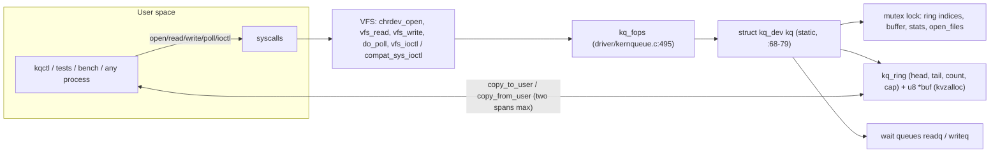
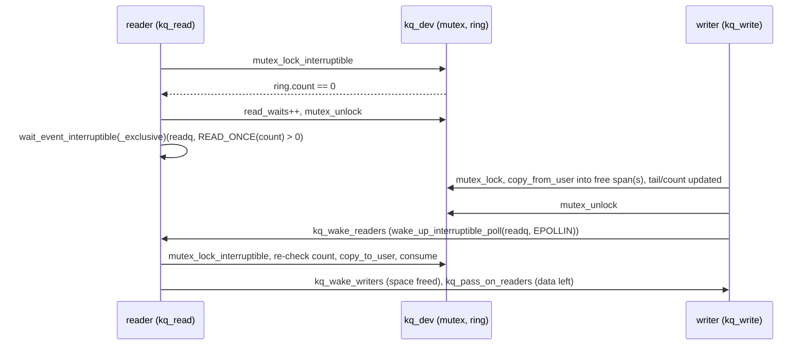

# KernQueue: technical handoff

This report lets a reviewer or assistant who wasn't part of earlier work
understand, assess and continue KernQueue. It was written by inspecting the
repository at commit `5ec6551` (branch `main`): the source, scripts, committed
test logs (`docs/evidence/`, `bench/results/`) and Git history. The
unprivileged checks were also re-run on 2026-10-25; §8 says which results came
from that re-run.

**Evidence conventions.** Line numbers refer to commit `5ec6551`.
- **VERIFIED:** backed by a committed log or by today's re-run.
- **UNVERIFIED:** no evidence exists; it's labelled as such where it appears.
- **HYPOTHESIS:** an explanation that fits the data but wasn't proven.

Personal paths are written as `<repo>` (the checkout), `~` (the WSL home) and
`%UserProfile%` (Windows).

---

## 1. Project overview

**What it is.** KernQueue is a loadable Linux kernel module, written in C,
that creates one character device, `/dev/kernqueue`. The device exposes a
bounded, blocking, thread-safe **byte FIFO** shared by every process that
opens it. It comes with a user-space C toolkit:
- a CLI client (`kqctl`)
- a fork-per-test functional suite
- a multi-producer/multi-consumer (MPMC) integrity stress test
- a throughput/latency benchmark
- a ring-buffer unit test
- a 32-bit compat-ABI test
- shell scripts that build, load, test and validate it, including under
  kernel sanitizers

**Problem it addresses.** It's a learning and portfolio project, intended as
preparation for systems-software (GPU/Tegra driver) roles. It doesn't drive
hardware. Its purpose is to exercise, correctly and verifiably, the parts
every driver needs:
- device registration and module lifecycle
- the kernel/user copy boundary, including partial faults
- locking that respects the kernel's sleeping rules
- wait-queue blocking, `O_NONBLOCK` and `poll`
- an ABI-stable ioctl interface

**Use cases.** Teaching and demonstrating driver internals; an inter-process
byte/record queue with pipe-like semantics; a platform for experimenting with
wake-up strategies and measuring them.

**Technologies.**
- **Driver:** C (kernel style, Kbuild).
- **User space:** C11, POSIX threads, `poll`, `mmap`/`mprotect`.
- **Glue and analysis:** Bash and Python 3.
- **Tooling:** GCC 11/13, GNU Make, Linux 6.6 (Microsoft WSL2 kernel), sparse,
  checkpatch.pl, ASan/UBSan/TSan, lockdep, KASAN, KCSAN.

**What's technically interesting**, with the evidence for each:
- **Pipe-like semantics with `PIPE_BUF`-style atomic writes** (≤ 4096 bytes),
  precise partial-transfer handling on page faults, and a `poll` `EPOLLOUT`
  threshold chosen so a poll loop can't spin on `EAGAIN`.
- **A measured thundering-herd problem and its fix.** The fix uses exclusive,
  need-aware wake-ups through a **custom wait-queue wake function** that
  returns 0 to skip waiters whose write wouldn't fit. Wake-ups are handed on
  when data or space is left over. The original strategy is kept behind the
  `exclusive_wake` module parameter, so both can be compared in the same
  session.
- **Same-session A/B benchmarking against a named-pipe baseline**, including a
  configuration where the fix is *slower*, reported as such.
- **Validation under custom debug kernels:**
  - lockdep + `DEBUG_ATOMIC_SLEEP` + KASAN
  - strict KCSAN, with per-access attribution of KCSAN reports
  - a **KCSAN mutation check** proving KCSAN catches kernqueue's own bug class
- **Reproducing a vendor kernel build tree** for an out-of-tree module on
  WSL2, with config-difference vetting and symbol-CRC verification against
  shipped modules.

---

## 2. Environment

All results below come from this one environment. VERIFIED by
`scripts/env_info.sh` output in `docs/evidence/*/environment.txt` and by
today's re-run.

| Item | Value |
|---|---|
| Host | Windows 11 (10.0.26200) on an AMD Ryzen 7 5800H (8 cores/16 threads) |
| Linux environment | **WSL2** (a Hyper-V VM), WSL 2.5.7.0, distribution Ubuntu 24.04.4 LTS |
| Kernel | `6.6.87.1-microsoft-standard-WSL2`, x86_64, SMP, `PREEMPT_DYNAMIC`, `CONFIG_MODVERSIONS=y`, `CONFIG_DEBUG_INFO_BTF(_MODULES)=y`, `CONFIG_MODULE_SIG` not set |
| CPUs / memory visible to Linux | 16 vCPUs / 6.7 GiB |
| User-space compiler | gcc 13.3.0 (Ubuntu 13.3.0-6ubuntu2~24.04.1) |
| Module compiler | gcc-11 11.5.0 (the WSL kernel itself was built with gcc 11.2) |
| Build tools | GNU Make 4.3, git 2.43.0, pahole v1.25, Python 3.12.3 |
| Debug tools present | gdb 15.1, strace 6.8, sparse 0.6.4 and cpio 2.15 (both installed user-locally, see below) |
| Kernel headers | **None shipped** for WSL kernels. `/lib/modules/$(uname -r)/build` is absent. A matching tree was built from `microsoft/WSL2-Linux-Kernel` tag `linux-msft-wsl-6.6.87.1` into `~/kq-kbuild/linux` with `/proc/config.gz`, gcc-11 and `LOCALVERSION=`; it has `Module.symvers` (VERIFIED today) |
| Debug kernel trees | `~/kq-kbuild/linux-debug` (release `...-kqdebug`) and `~/kq-kbuild/linux-kcsan` (`...-kqkcsan`): git worktrees of the stock tree |

**Important environment restrictions.**
- **`sudo` needs a password.** Every load/unload, and therefore every device
  test, needs a human at a terminal. Unattended automation can't run them.
- **A module crash takes down the WSL VM**, including Docker Desktop's
  distro, but not Windows.
- **`perf` is unavailable** under WSL, so no profiling has been done.
- **Booting a custom kernel** needs `%UserProfile%\.wslconfig`
  (`kernel=...`) plus `wsl --shutdown`. That's a system-configuration change,
  and it has been reverted. At handoff time **there is no `.wslconfig`** and
  the stock kernel is running (VERIFIED: `uname -r`).
- **WSL's VM start timeout.** A KCSAN kernel with lockdep, KCSAN's boot
  selftest and early-enable never booted (`HCS_E_CONNECTION_TIMEOUT`, twice).
  After the KCSAN session, WSL also stopped responding once.
- **TSan under WSL** needs `setarch $(uname -m) -R`, because of the
  mmap-entropy layout.
- **WSL's DNS was intermittently unreliable.** Two packages, `cpio` (needed
  by `CONFIG_IKHEADERS`) and `sparse`, were downloaded from the Ubuntu archive
  on the Windows side, checked against apt's SHA-256, and unpacked user-locally
  into `~/kq-kbuild/tools` rather than installed system-wide.
- **The checkout path contains spaces.** Kbuild can't handle that in `M=`, so
  `scripts/build_module.sh` stages sources in `~/.cache/kernqueue-build`.

**Tools actually used:**
- gcc, make, Kbuild (`W=1`)
- `checkpatch.pl`, sparse (`C=2`)
- ASan, UBSan, TSan (user space)
- lockdep, `DEBUG_ATOMIC_SLEEP`, KASAN, `DEBUG_LIST`, KCSAN (debug kernels)
- `modprobe --dump-modversions`, `readelf`, `objdump`, `nm`, `dmesg`

**Tools never used:** gdb, strace, ftrace and dynamic debug are available but
were not used for any recorded result.

---

## 3. Repository structure

Tracked files (`git ls-files`, commit `5ec6551`). Generated output lives in
`build/`, which `.gitignore` excludes.

```
.
├── .gitattributes            LF line endings for every file (eol=lf)
├── .gitignore                build/ and kernel build artifacts (*.o, *.ko, *.mod.c, *.cmd, ...)
├── Makefile                  top-level: user programs, module, sparse, tests, bench, sanitize
├── README.md                 prerequisites, build/load/test instructions, troubleshooting, limitations
├── driver/
│   ├── kernqueue.c           the kernel module (594 lines)
│   ├── kq_ring.h             ring index arithmetic shared with a user-space unit test (147 lines)
│   ├── Kbuild                obj-m := kernqueue.o; adds ../include to the include path
│   └── Makefile              direct out-of-tree build (KDIR=...); usually called via scripts/build_module.sh
├── include/
│   └── kernqueue.h           user-space API (uapi): device path, sizes, struct kq_stats, ioctl numbers
├── user/
│   ├── kq_common.{c,h}       helpers: device path, clocks, KQ_IOC_GET_STATS, size parsing, record format
│   └── kqctl.c               CLI client: stats | write | read | dump | reset | clear-stats | poll
├── tests/
│   ├── kq_test.{c,h}         fork-per-test runner with parent-side timeouts
│   ├── test_functional.c     27 functional tests of the device contract
│   ├── test_stress.c         MPMC integrity stress test (+ --inject fault modes for self-testing)
│   ├── test_ring.c           unit test of driver/kq_ring.h against a reference model
│   ├── test_compat32.c       freestanding i386 program testing the 32-bit compat ioctl path
│   └── debugcheck/
│       ├── kq_debugcheck.c   deliberately buggy module proving sanitizers are live
│       └── Kbuild
├── bench/
│   ├── kq_bench.c            throughput + latency (reservoir-sampled percentiles) benchmark
│   ├── run_bench.sh          benchmark matrix: kernqueue (labelled by wake mode) vs a FIFO
│   ├── summarize.py          medians -> Markdown table
│   └── results/20261025-010601/   committed raw CSV, environment, summary (81 runs)
├── scripts/
│   ├── prepare_wsl_kdir.sh   clone + configure + full-build the matching WSL kernel tree
│   ├── prepare_debug_kdir.sh build a debug variant: kasan (lockdep+KASAN) or kcsan (strict KCSAN)
│   ├── build_module.sh       build kernqueue.ko (stages if path has spaces; regenerates BTF; KQ_SPARSE=1)
│   ├── load_module.sh        sudo insmod + vermagic check + node chgrp/chmod 0660
│   ├── unload_module.sh      sudo rmmod
│   ├── run_device_tests.sh   full device cycle (optionally --bench) + kernel-log scan
│   ├── run_stress.sh         7-configuration stress suite (KQ_SOAK_SECONDS adds a soak run)
│   ├── run_debug_checks.sh   device cycle under a debug kernel + checker self-tests
│   ├── kcsan_mutant_check.sh KCSAN mutation check on a de-marked copy of kernqueue
│   ├── kcsan_attribute.py    attribute KCSAN reports by the racing-access functions
│   ├── test_harness_fifo.sh  self-test of test_stress against a named pipe, with fault injection
│   ├── test_kqctl.sh         13-check smoke test of kqctl
│   ├── ab_wake.sh            interleaved same-session A/B of exclusive_wake=1 vs 0
│   └── env_info.sh           environment summary for logs
└── docs/
    ├── design.md             semantics, ioctl ABI, ring invariants, locking and wake-up argument
    ├── learning_notes.md     concept explanations with exercises
    ├── testing.md            test layers, debugging tools, sanitizer procedure
    ├── implementation_status.md   detailed run-by-run record
    ├── benchmark_results.md  methodology, results, analysis
    ├── interview_prep.md     question bank + résumé text
    ├── evidence/             raw logs from every device run (see §8)
    ├── PROJECT_HANDOFF.md    this file
    └── PROJECT_STATUS.md     short operational status
```

`docs/evidence/` holds `run1-v1`, `run2-v2` and `run3-v2` (stock kernel),
`debug-run1-selftest-order` and `debug-run2` (KASAN kernel), `kcsan-run1`,
`kcsan-run2` and `kcsan-mutant` (KCSAN kernel), and `ab-min-capacity`. These
logs contain absolute paths from the development machine.

---

## 4. Architecture and data flow





**Device registration and lifecycle** (`kq_init`, `driver/kernqueue.c:506–577`):
1. Validate `capacity` against `[KQ_MIN_CAPACITY, KQ_MAX_CAPACITY]` =
   [4096, 16 MiB] (`include/kernqueue.h:34–35`). An invalid value returns
   `-EINVAL` and is logged.
2. `mutex_init`, `init_waitqueue_head` ×2, `kq_ring_init`.
3. `kvzalloc(capacity)` (`:527`).
4. `alloc_chrdev_region` (dynamic major, `:531`).
5. `class_create(name)` (the 6.4+ one-argument form, `:536`).
6. `device_create`, which makes devtmpfs/udev create `/dev/kernqueue` (`:548`).
7. `cdev_init` + `cdev_add` **last** (`:556`). From then on the device is
   live, and no later step can fail.

Errors unwind through `goto` labels in reverse order (`:564–572`). `kq_exit`
(`:580`) runs `cdev_del` → `device_destroy` → `class_destroy` →
`unregister_chrdev_region` → `kvfree`. Freeing in exit is safe because
`.owner = THIS_MODULE` (`:496`) makes every open file hold a module reference,
so `rmmod` fails with `EBUSY` while any fd is open.

**File operations** (`kq_fops`, `:495–504`; there is no `.llseek`):

| Op | Function | Responsibility |
|---|---|---|
| open | `kq_open` (`:208`) | `private_data = container_of(i_cdev)`, `stream_open()` (lseek/pread/pwrite → `ESPIPE`), `open_files++` under the mutex |
| release | `kq_release` (`:232`) | `open_files--`; runs once per open file description; data persists |
| read | `kq_read` (`:300`) | blocking/non-blocking dequeue of 1..count bytes |
| write | `kq_write` (`:348`) | atomic ≤ 4096 B, or a short write above that |
| poll | `kq_poll` (`:402`) | register on both queues, then sample `READ_ONCE(count)` |
| unlocked_ioctl | `kq_ioctl` (`:446`) | GET_STATS / RESET / CLEAR_STATS, `ENOTTY` otherwise |
| compat_ioctl | `compat_ptr_ioctl` | 32-bit callers; enough because the only ioctl struct is all-`__u64` |

**Ring buffer** (`driver/kq_ring.h`):
- `struct kq_ring { head, tail, count, cap }` (`:46`). Queue naming: `head`
  is the next byte to read and `tail` the next byte to write. This is the
  opposite of `<linux/circ_buf.h>`.
- Invariants I1–I5 (`:18–22`): `cap > 0`; `head, tail < cap`;
  `count <= cap`; `tail == (head + count) mod cap`; the bytes are FIFO-ordered
  from `head`. `count` resolves `head == tail` being either empty or full.
- `kq_ring_split` (`:91`) turns a transfer into at most two contiguous spans.
- `kq_ring_advance` (`:78`) wraps with a conditional subtraction, valid for
  `n <= cap <= SIZE_MAX/2`.
- `count` is updated with `KQ_WRITE_ONCE` (`:38`; a plain assignment in the
  user-space test build, `:43`).
- `kq_ring_valid` (`:140`) checks I1–I4. The driver runs it after every
  transfer under the lock: `kq_check_ring` → `WARN_ON_ONCE` (`kernqueue.c:202`).

**Data movement.** All user memory is accessed only through `copy_to_user`
and `copy_from_user`, in `kq_copy_out` (`:248`) and `kq_copy_in` (`:276`),
looping over the spans:
- **Read.** It consumes exactly the bytes that reached user space. A fault on
  the first byte gives `-EFAULT` with nothing consumed.
- **Atomic write** (≤ `KQ_ATOMIC_MAX`). A fault anywhere publishes **nothing**
  (`done = 0` at `:293–294`; the bytes sit beyond `tail` and are invisible).
- **Non-atomic write.** The copied prefix is published.
- **Clamping.** The user-supplied count is clamped with `min()` before
  arithmetic (`:333`, `:380–382`).

**Blocking and non-blocking** (`kq_read` `:312–331`, `kq_write` `:362–377`):
1. Take the mutex and loop on the condition.
2. If `O_NONBLOCK` is set (read from `filp->f_flags` on every call), count it
   in `*_eagain` and return `-EAGAIN`.
3. Otherwise count it in `*_waits`, unlock, and sleep on the wait queue.
4. On wake-up, retake the mutex and re-check.
5. On a signal or a failed `mutex_lock_interruptible`, hand the wake-up on
   and return `-ERESTARTSYS`. That becomes `EINTR`, or a transparent restart
   with `SA_RESTART`.

A write's required free space is `kq_write_need` (`:87`): `count` for an
atomic write, 1 otherwise.

**Wait queues and wake-up conditions.** There are two module parameters,
both `0444`, i.e. fixed at load time:
- **`exclusive_wake=N`** (v1 behaviour). Readers use
  `wait_event_interruptible(readq, kq_has_data)` and writers
  `wait_event_interruptible(writeq, kq_has_space(need))`. Every event wakes
  every waiter.
- **`exclusive_wake=Y`** (default, v2):
  - Readers sleep with `wait_event_interruptible_exclusive` (`:140`).
  - Writers use an open-coded exclusive wait, `kq_wait_for_space` (`:176`),
    whose entry has the custom wake function `kq_writer_wake` (`:159`).
    It returns 0 unless that writer's `need` fits, so `__wake_up_common`
    skips it without using the wake-one budget.
  - **Hand-off.** `kq_pass_on_readers` and `kq_pass_on_writers` (`:125`,
    `:131`) wake the next waiter after any operation that leaves data or space
    behind, or after a woken task bails out.
  - **Wake order.** Wake-ups are issued after `mutex_unlock`.
  - **Event types.** `kq_wake_readers`/`kq_wake_writers` (`:108`, `:113`) use
    `wake_up_interruptible_poll`, which wakes every `poll` waiter plus one
    exclusive waiter.

**Poll readiness** (`kq_poll`, `:402`):
- `EPOLLIN|EPOLLRDNORM` if the fd is readable and `count > 0`.
- `EPOLLOUT|EPOLLWRNORM` if the fd is writable and `cap - count >= 4096`, so
  that `EPOLLOUT` guarantees any atomic write will succeed.

**Ioctls** (`include/kernqueue.h:63–70`, magic `0xBA`, unregistered):

| Command | Encoding | Behaviour | Errors |
|---|---|---|---|
| `KQ_IOC_GET_STATS` | `_IOR(0xBA, 1, struct kq_stats)` | snapshot under the mutex, `copy_to_user` after unlocking (`kq_get_stats`, `:424`) | `EFAULT` |
| `KQ_IOC_RESET` | `_IO(0xBA, 2)` | `kq_ring_reset`, `resets++`, wake writers | `EBADF` without `FMODE_WRITE` |
| `KQ_IOC_CLEAR_STATS` | `_IO(0xBA, 3)` | zero the cumulative counters | `EBADF` without `FMODE_WRITE` |
| other | | | `ENOTTY` (type mismatch or unknown number) |

`struct kq_stats` (`include/kernqueue.h:43–56`) has 12 `__u64` fields, no
padding, 96 bytes in both ABIs:
- live state: `capacity`, `used`, `open_files` (filled at snapshot time)
- cumulative counters: `bytes_written`, `bytes_read`, `write_calls`,
  `read_calls`, `write_waits`, `read_waits`, `write_eagain`, `read_eagain`,
  `resets`

---

## 5. Implementation details

### 5.1 Driver core (`driver/kernqueue.c`)
- **Single static instance** `struct kq_dev kq` (`:68–79`): one queue shared
  by all opens. There's no per-open state beyond `private_data`.
- **Mutex rather than spinlock**, because `copy_*_user` can fault and sleep.
  Alternatives considered (design.md §4): a spinlock with a bounce buffer, a
  lock-free SPSC ring like kfifo, or separate reader and writer locks.
- **`stream_open()` with no `.llseek`.** Verified in the 6.6 source:
  `vfs_llseek` returns `-ESPIPE` when `FMODE_LSEEK` is clear, so no version
  guard is needed.
- **Init order puts `cdev_add` last**, and `device_create` before it. Opening
  the node before `cdev_add` gives `-ENXIO`, which is harmless.
- **Known limitations:**
  - user copies happen while holding the mutex, so a `userfaultfd`-backed
    buffer can stall every other user
  - no fairness guarantee between large and small writers
  - one device instance
  - capacity is configurable only at load time; there's no resize ioctl

### 5.2 Ring logic (`driver/kq_ring.h`)
- Pure index bookkeeping, kernel-independent through `#ifdef __KERNEL__`, so
  `tests/test_ring.c` compiles the exact same code.
- **Alternatives considered:** a wasted slot, or kfifo-style free-running
  power-of-two indices. An explicit `count` was chosen because it works for
  any capacity and uses every byte.

### 5.3 Wake-up strategy (v1 → v2)
- **v1, wake-all,** measured a thundering herd. In device run 1, 16 writers ×
  1 reader × 4 KiB records took 27.77 s with 1,268,318 writer sleeps for
  320,000 records (`docs/evidence/run1-v1/stress-default.log`).
- **v2** is described in §4. The design and its no-lost-wake-up argument are
  in `docs/design.md` §4. `fs/pipe.c` in 6.6 uses the same core idea
  (`wait_event_interruptible_exclusive` plus `wake_next_reader/writer`). It
  also wakes only on full→not-full and empty→non-empty transitions, which
  KernQueue does **not** do.
- **Limitation, measured:** v2 is not uniformly faster (see §9).

### 5.4 User-space API and tools
- **`include/kernqueue.h`:** `KQ_ATOMIC_MAX = 4096`; capacity range and
  default (64 KiB); the ioctl definitions.
- **`user/kq_common.c`:**
  - record format (`struct kq_rec_hdr` in `kq_common.h`, 32 bytes: magic,
    writer, seq, ts_ns, len, csum)
  - `kq_rec_build`/`kq_rec_verify` (`:106`, `:125`), using a payload derived
    from (writer, seq) and FNV-1a
  - strict `kq_parse_size` (`:44`)
- **`user/kqctl.c`:** `main` at `:127`; commands at `:165–187`.

### 5.5 Test framework (`tests/kq_test.c`)
- **One child process per test.** `kq_test_main` (`:85`) forks a child for
  each test, and `wait_child` (`:42`) enforces a parent-side timeout (10 s
  default) and then `SIGKILL`.
- **Outcomes** are `PASS`, `FAIL`, `TIMEOUT` and `STUCK` (couldn't be
  reaped, which suggests uninterruptible sleep; the run aborts).
- **Children** use `PR_SET_PDEATHSIG`. The exit status is nonzero on any
  failure, and "no test matched" is a failure.

### 5.6 Functional tests (`tests/test_functional.c`)
There are 27 tests (table at `:989–1015`). Each test calls `fresh()`, which
resets the device and clears its counters, then checks *exact* expected
values. Blocking tests synchronise on the driver's `read_waits`/`write_waits`
counters (`WAIT_STAT_GE`) rather than sleeps. Partial-fault tests use
`mmap` + `mprotect(PROT_NONE)` guard pages, and deliberately invalid pointers
go through a volatile `bad_ptr()` so fortify checks don't reject them at
compile time.

**Assumption:** on x86-64, the partial-fault tests expect the exact faulting
byte count (100 / 5000), because x86 `copy_*_user` stops exactly at the
fault. Other architectures accept a range (`#if defined(__x86_64__)`).

### 5.7 Stress test (`tests/test_stress.c`)
- **Records.** Writers (`writer_main`, `:173`) send fixed-size records.
  Readers (`reader_main`, `:206`) verify:
  - exactly one record per `read`
  - magic, length, checksum and every payload byte
  - per-reader strictly increasing sequence numbers per writer, which must
    also be consecutive when there's a single reader
  - exactly-once delivery, via a per-writer atomic bitmap plus a final sweep
- **Counter cross-check.** On a kernqueue device, the driver's byte and call
  counters must match.
- **Shutdown** uses one poison record per reader. FIFO order puts them behind
  all real data.
- **Watchdog.** `watchdog_main` (`:261`) prints progress and exits 3 on
  timeout.
- **`--inject dup|skip|corrupt|split`** deliberately breaks one guarantee,
  for the harness self-test.

### 5.8 Benchmark (`bench/kq_bench.c`)
- W writers and R readers; 1 s warm-up, then a measured window.
- **Latency:** per-thread reservoir sampling (`res_add`, `:94`), with
  percentiles from merged samples (`summarize`, `:229`) and an exact max.
- **Metrics:** throughput is reader bytes over the window. End-to-end latency
  is receive time minus the timestamp embedded in the record.
- **Options:** `--rate` (throttling), `--nonblock`, `--csv`.
- It doesn't verify data integrity; `test_stress` does that.

### 5.9 Build and validation scripts (`scripts/`)
- **`prepare_wsl_kdir.sh`:** clones the tag matching `uname -r`, uses
  `/proc/config.gz`, diffs the resulting `.config` against the running config
  (with a reviewed list of tolerated differences), full-builds with
  `LOCALVERSION=`, and verifies `kernelrelease == uname -r` and that
  `Module.symvers` exists.
- **`build_module.sh`:**
  - stages the sources when the path has spaces
  - builds with the tree's recorded CC and `W=1`
  - regenerates module BTF against `/sys/kernel/btf/vmlinux` (fixes a "BTF
    mismatch" seen in run 1)
  - `KQ_SPARSE=1` adds `C=2`
- **`run_device_tests.sh`:**
  - functional + stress tests in both wake modes; min and max capacity;
    `kqctl` and compat32 tests; rejection of bad parameters
  - optionally the benchmark (`--bench`)
  - a kernel-log scan from a marker, which fails if the marker is missing
    (the ring buffer wrapped)
  - KCSAN reports split out and attributed by `kcsan_attribute.py`
  - a generic regex for WARNING/BUG/Oops/error/invalid/mismatch/lockdep
- **`prepare_debug_kdir.sh [kasan|kcsan]`**, **`run_debug_checks.sh`**,
  **`kcsan_mutant_check.sh`**: see §8.

### 5.10 Discrepancies with the original specification
The original request is the one in the project's first instructions.

| Spec item | Actual implementation |
|---|---|
| "Configurable buffer capacity" | Load-time module parameter only; no runtime resize |
| Device node permissions | Not specified; implemented as `load_module.sh` running `chgrp <user's group>` + `chmod 0660`. There's no udev rule, and a manual `insmod` leaves the node `root:root 0600` |
| "Safe reset where appropriate" | `KQ_IOC_RESET`, which requires a writable fd |
| Latency percentiles "where meaningful" | Reported. Unthrottled end-to-end latency measures queueing delay, as documented; the `--rate` mode exists but has **never been run** |

---

## 6. Concurrency and correctness

**Shared state** (`struct kq_dev`, `:68–77`):

| State | Protection |
|---|---|
| `ring.head`, `ring.tail`, buffer contents, `stats`, `open_files` | `kq.lock` (mutex) |
| `ring.count` | written only under the mutex, with `WRITE_ONCE`; also read **without** the lock via `READ_ONCE` in `kq_has_data`, `kq_has_space` and `kq_poll` (`:95`, `:100`, `:411`) |
| `ring.cap`, `buf` | written once in `kq_init` before `cdev_add`, then read-only |
| `readq`, `writeq` | the wait queues' internal spinlocks |
| `exclusive_wake`, `capacity` | module parameters (`0444`), fixed after load |

The lockless reads are **hints**: every decision is re-made under the mutex.

**Lock order.** There's one driver lock. It is never held while sleeping on a
wait queue, and no wait-queue lock is held while taking it: wake functions run
under the wait-queue spinlock and only `READ_ONCE` the count. Lockdep
recorded `&kq.lock` with 183–187 forward dependencies (lock classes taken
while it's held). They weren't itemised; presumably they're the page-fault
and mm locks reached through `copy_*_user` (UNVERIFIED). **Lockdep reported
no problem in two KASAN-kernel boots, and `debug_locks` stayed at 1.**

**Blocking and waking.** The waiter is queued *before* the condition is
tested (`wait_event_*`, or `prepare_to_wait_exclusive` at `:188`). Wakers call
`wake_up_*` unconditionally after the state change and after unlocking; they
never use a `waitqueue_active()` shortcut. That ordering through the
wait-queue spinlock is what prevents lost wake-ups. In exclusive mode, the
hand-off covers both cases: a task woken but finding the resource gone, and a
task woken but interrupted. The full argument is in `docs/design.md` §4.

**Shutdown and interruption:**
- every user-facing sleep is interruptible: `wait_event_interruptible*`,
  `mutex_lock_interruptible`
- `kq_release` uses a plain `mutex_lock`, because release can't fail
- `rmmod` is impossible while any fd is open (module refcount through
  `fops.owner`)

**Evidence of concurrent correctness, not a proof:**
- **Stress runs.** 105 runs in 7 device-test sessions, plus 6 A/B runs, all
  passing. 46.06M records were integrity-checked in total (44.86M in the 105
  cycle runs, 1.2M in the A/B runs).
- **KASAN kernel.** Clean under lockdep, `DEBUG_ATOMIC_SLEEP`, KASAN and
  `DEBUG_LIST` (2 boots).
- **Strict-KCSAN kernel.** Clean in 2 boots: 0 of 351 printed KCSAN reports
  had a racing access in kernqueue.
- **KCSAN can see kernqueue.** The mutation check (`ring.count` markings
  removed) produced 15 KCSAN reports attributed to kernqueue.

**This is not a proof of race freedom.** KCSAN samples rather than checking
every access. Only x86-64 under WSL was tested, and the KCSAN kernel had no
lockdep.

**Concerns found during this inspection:**
1. **Spurious `poll` wake-ups (SUSPECTED inefficiency, unmeasured).** These
   calls wake *every* `poll` waiter on the relevant queue even when the
   readiness condition still doesn't hold (e.g. `EPOLLOUT` needs ≥ 4096 bytes
   free):
   - `kq_wake_writers()` after every read (`:340–341`)
   - `kq_pass_on_writers()` after every write and every bail-out
     (`:391`, `:374`)

   Pollers re-sample and go back to sleep, so correctness is unaffected. Not
   measured.
2. **The uncontended path pays an extra wake call.** In exclusive mode every
   read and write also makes a hand-off wake call: a wait-queue spinlock round
   trip even with no sleepers. This is the probable cause of the measured
   8–11% single-producer slowdown (§9). PLAUSIBLE, not profiled.
3. **One path is reasoned about but not tested.** "Woken exclusively, then
   interrupted before taking the mutex" is handled by the hand-off at
   `:326–330` and `:371–376`, but no deterministic test covers it.
4. **The synthetic KCSAN `data_race` self-test doesn't trigger** (see §10).
   This is a validation-tool issue, not a kernqueue defect.

No confirmed correctness defect in the driver was found.

---

## 7. Build and run instructions

`<repo>` is the checkout. Run everything inside WSL Ubuntu.

### 7.1 Executed successfully (VERIFIED; build commands re-run 2026-10-25)
```bash
# one-time prerequisites (needs sudo; run during setup, cpio/sparse installed user-locally instead):
sudo apt-get install -y flex bison libelf-dev libssl-dev dwarves gcc-11 gdb strace bc
# matching kernel tree (~30 min, ~10+ GB):
bash scripts/prepare_wsl_kdir.sh            # PATH must include ~/kq-kbuild/tools/root/usr/bin for cpio
# user-space programs (0 warnings, -Werror):
make user
# module for the running kernel (0 warnings at W=1):
make module                                 # -> build/kernqueue.ko
make sparse                                 # module build with sparse C=2: no warnings
# no-driver checks:
make test-unit                              # test_ring 5/5
make test-harness                           # 4 passes + 7/7 injected faults detected
make sanitize                               # the two above under ASan+UBSan
```

Device commands, executed with a human typing the sudo password:
```bash
scripts/load_module.sh [capacity=N] [exclusive_wake=0|1]   # insmod + node group-rw
build/kqctl stats ; build/kqctl write "hello" ; build/kqctl read 100
build/test_functional                       # 27 tests
scripts/run_stress.sh build/test_stress     # 7 configurations
scripts/unload_module.sh                    # rmmod
bash scripts/run_device_tests.sh [--bench]  # full cycle, one sudo prompt
bash scripts/ab_wake.sh 4096 4 4 4096 3     # wake-mode A/B
```

Debug kernels. These change system configuration; they were executed, then
reverted:
```bash
bash scripts/prepare_debug_kdir.sh kasan     # or: kcsan
# copy ~/kq-kbuild/linux-<variant>/arch/x86/boot/bzImage to Windows, then create
# %UserProfile%\.wslconfig:   [wsl2]  kernel=C:\\path\\to\\bzImage   (+ kernelCommandLine=log_buf_len=16M for KCSAN)
wsl --shutdown                               # from Windows; restarts all distros
bash scripts/run_debug_checks.sh             # detects the variant from uname -r
# revert: delete %UserProfile%\.wslconfig, wsl --shutdown, then `make module` for the stock kernel
```

### 7.2 Expected to work, not executed in this form
- `make bench` (runs `bench/run_bench.sh` on its own). The benchmark was run
  only through `run_device_tests.sh --bench`.
- `make check-device`, a wrapper around `run_device_tests.sh`.
- `KQ_SOAK_SECONDS=N scripts/run_stress.sh`: the soak run was never executed.
- `build/kq_bench --rate N`: never executed.
- Building on a regular distro with `linux-headers-$(uname -r)`.

**Cleanup:**
```bash
make clean
```
Optionally remove the debug trees:
```bash
git -C ~/kq-kbuild/linux worktree remove --force ~/kq-kbuild/linux-debug
```
and the same for `linux-kcsan`.

---

## 8. Testing and verification

Device runs are listed under their evidence directories in `docs/evidence/`.
The log scan treats WARNING/BUG/Oops/lockdep/error/invalid/mismatch lines as
failures. "Not run" means there is no evidence.

| # | Test | Purpose | How executed | Expected | Actual | Status | Evidence |
|---|---|---|---|---|---|---|---|
| 1 | Ring unit test (`test_ring`: init, advance, split, full_vs_empty, random_model) | head/tail/count arithmetic vs a flat-array model, 9 capacities incl. non-powers-of-2; overflow edge `SIZE_MAX/2` | `make test-unit` | 5/5 | 5/5 | **PASS** (re-run 2026-10-25) | console output (not committed) |
| 2 | Ring mutation check | the unit test can fail | 4 sed mutants of `kq_ring.h` (one-off script) | all detected | 4/4 detected | **PASS** (once, during development) | not committed; script not in repo |
| 3 | Harness self-test | `test_stress` passes on a correct FIFO and detects dup/skip/corrupt/split | `make test-harness` | 4 pass, 7 faults detected | as expected | **PASS** (re-run 2026-10-25) | console output |
| 4 | ASan+UBSan | memory/UB errors in #1 and #3 | `make sanitize` | no reports | none | **PASS** (re-run 2026-10-25) | console output |
| 5 | TSan | data races in the user-space harness | TSan build, `setarch -R` | no reports | none | **PASS** (once, during development) | not committed |
| 6 | Build hygiene | warnings | `make user` (`-Werror`), `make module` (`W=1`) | 0 warnings | 0 | **PASS** (re-run) | console |
| 7 | checkpatch | kernel style | `checkpatch.pl --no-tree -f` | 0/0 | driver, ring, uapi 0/0; `kq_debugcheck.c` 1 warning (intentional `volatile`) | **PASS** (re-run) | console |
| 8 | sparse | `__user`/address-space misuse | `make sparse` | no warnings | none; a planted `memcpy` into a `__user` buffer was flagged | **PASS** (re-run; mutant once) | console |
| 9 | Module CRC check | module ABI matches the running kernel | `modprobe --dump-modversions` vs shipped modules | all match | 39/39 (one via `sctp.ko`) | **PASS** | console (not committed) |
| 10 | Functional suite (27) | open modes, counters, zero-length, non-blocking, fcntl toggle, fill, atomic writes, wraparound stream, blocking read/write, signals (EINTR, SA_RESTART), poll states and wake-ups, ESPIPE, bad pointers incl. a kernel address, partial read fault (contiguous and wrapped), atomic write fault, large partial write, ioctl errors (ENOTTY ×4, EFAULT ×4, EBADF), reset/clear, reset wakes writer, 3 exclusive-wake hand-off tests, shared/persistent queue | `build/test_functional` at 4 configs per cycle | all pass | 24/24 ×3 (run 1, v1, 24 tests); 27/27 ×4 in runs 2, 3, debug 1–2, KCSAN 1–2 | **PASS** (720 executions) | `docs/evidence/*/functional-*.log` |
| 11 | Stress suite (7 configs) | MPMC integrity: 1×1, 4×4, 8×8, 16×1@4 KiB, 1×16@32 B, 4×4 and 8×8 non-blocking | `scripts/run_stress.sh` (both wake modes) | all pass | 7/7 per suite per mode | **PASS** | `stress-default.log`, `stress-wakeall.log` |
| 12 | Min-capacity stress | integrity when the ring holds one 4 KiB record | 2 runs per cycle | pass | 2/2 per cycle | **PASS** | `stress-min*.log` |
| 13 | Parameter validation | out-of-range `capacity` rejected | `insmod capacity=100/4095/16777217` | rejected | 3/3 every cycle | **PASS** | `device-cycle.log`, dmesg |
| 14 | Kernel-log scan | no warnings or oopses during the cycle | `run_device_tests.sh` | clean | clean in all runs; run 1 contained "BTF mismatch", which the then-scan didn't match (fixed in run 2) | **PASS** (run 1 caveat) | `dmesg*.log` |
| 15 | kqctl smoke test | CLI behaviour (13 checks) | `scripts/test_kqctl.sh` | 13/13 | 13/13 (run 3, debug 1–2, KCSAN 1–2) | **PASS** | `kqctl.log` |
| 16 | 32-bit compat | ioctl/read/write via `compat_sys_ioctl` → `compat_ptr_ioctl` (13 checks) | `build/test_compat32` | PASS | PASS (same runs as #15) | **PASS** | `compat32.log` |
| 17 | lockdep/KASAN cycle | full cycle under the debug kernel | `run_debug_checks.sh` on `-kqdebug` | no reports, `debug_locks=1` | clean both boots; `&kq.lock`, `&kq.readq`, `&kq.writeq` tracked | **PASS** | `debug-run1-*`, `debug-run2` |
| 18 | Checker self-tests (KASAN kernel) | checkers are live | `kq_debugcheck.ko bug=...` | 3 reports | run 1: `lock_order` **not reported** (lockdep had turned itself off after `atomic_sleep`'s "Invalid wait context"); run 2 (order fixed): 3/3 | **PASS** (run 2) / FAIL (run 1, cause found) | `selftest-*.log` |
| 19 | KCSAN cycle | no data races attributed to kernqueue | `run_debug_checks.sh` on `-kqkcsan` | 0 attributed | run 1: verdict **FAIL** under the first, coarse rule (125 reports had kernqueue on a stack; 0 racing accesses in kernqueue on replay); run 2: **PASS**, 168 reports, 0 attributed | **PASS** (run 2) | `kcsan-run1`, `kcsan-run2` (`dmesg-kcsan-attribution.txt`) |
| 20 | KCSAN mutation check | KCSAN can see kernqueue's accesses | `scripts/kcsan_mutant_check.sh` | ≥ 1 attributed race | 15 races in `kq_poll`/`kq_read`/`kq_write`; mutant stress 3/3 still passed | **PASS** | `docs/evidence/kcsan-mutant/` |
| 21 | KCSAN `data_race` self-test | synthetic kthread race is reported | `kq_debugcheck.ko bug=data_race` | report | not reported in 2 attempts (unbound 0.5 s; pinned to 2 CPUs for 2 s); `data_races` +1, unrelated | **FAIL** (informational; cause unknown) | `kcsan-run*/selftest-data_race.log`, `kcsan-stats-*` |
| 22 | Benchmark matrix | throughput/latency, kq-excl vs kq-all vs FIFO | `run_device_tests.sh --bench` | measurements | 9 configs × 3 reps × 3 targets | **RUN** | `bench/results/20261025-010601/` |
| 23 | Wake-mode A/B at min capacity | does v2 regress with a 1-record ring? | `scripts/ab_wake.sh 4096 4 4 4096 3` | measurements | v2 slower (§9); 6/6 stress pass | **RUN** | `docs/evidence/ab-min-capacity/` |
| 24 | Soak test | long-duration stability | `KQ_SOAK_SECONDS=N` | | | **NOT RUN** | none |
| 25 | Rate-limited latency | end-to-end latency on a lightly loaded queue | `kq_bench --rate` | | | **NOT RUN** | none |
| 26 | Interrupted-after-exclusive-wake path | hand-off on bail-out | none | | | **NOT TESTED** | none |
| 27 | Other kernels / architectures / bare metal | portability | none | | | **NOT RUN** | none |

---

## 9. Benchmarking and performance

**Raw data:** `bench/results/20261025-010601/`. The methodology and the full
table are in `docs/benchmark_results.md`.

**Workload and setup:**
- W writers and R readers; each `write()`/`read()` moves one fixed-size record
  of 64, 512 or 4096 B; writers are unthrottled.
- 1 s warm-up, then 5 s measured; 3 repetitions per configuration, with
  medians reported.
- Driver capacity 64 KiB. The baseline is a named pipe (default 64 KiB).
- Environment as in §2. CPUs not pinned. WSL VM with uncontrolled host noise.

**Metrics:**
- reader throughput (MB/s, k records/s)
- per-syscall latency p50/p99/p99.9/max (reservoir-sampled)
- end-to-end latency (embedded timestamp)
- driver sleep counts

**Results** (medians of 3; within-session ranges in `docs/benchmark_results.md`):

| W×R, size | FIFO MB/s | kq-all (v1 behaviour) | kq-excl (v2 default) | Verdict |
|---|---|---|---|---|
| 1×1, 64 B | 82.3 | 80.8 | 73.5 | v2 −9% (ranges don't overlap) |
| 1×1, 512 B | 677.9 | 636.6 | 583.4 | v2 −8% |
| 1×1, 4096 B | 4432.0 | 4720.3 | 4220.3 | v2 −11% |
| 4×4, 64 B | 134.7 | 99.5 | 96.1 | v2 −3% |
| 4×4, 4096 B | 2402.8 | 4705.5 | 4571.5 | tie (overlapping ranges) |
| 8×8, 512 B | 642.8 | 541.1 | 551.8 | tie |
| **16×1, 4096 B** | 1100.3 | **150.8** | **401.1** | **v2 2.7×**; writer p99 2975 → 1133 µs |
| **1×16, 64 B** | 19.1 | **2.2** (33.7k rec/s) | **5.9** (91.6k rec/s) | **v2 2.7×** |

**Minimum capacity** (4 KiB ring, 4×4, 4 KiB records; same-session A/B,
interleaved):

| | kq-all | kq-excl |
|---|---|---|
| Throughput | 482.1 MB/s | **97.3 MB/s** (v2 about 5× slower) |
| `write()` p50 | 15.9 µs | 166.4 µs |
| Integrity-checked stress | 3.46–3.66 s | 5.33–5.52 s |

**Integrity-checked stress timings agree with the 16×1 benchmark result.**
16×1 took 4.84 s, 4.91 s and 9.50 s (KASAN) with v2, against 29.04 s,
26.71 s and 39.53 s (KASAN) with wake-all, each pair from the same session.

**Interpretation.** The following are HYPOTHESES; nothing was profiled:
- The 8–11% single-producer cost is the extra hand-off wake call (§6).
- The minimum-capacity regression comes from losing pipelining: each hand-off
  pays an idle-vCPU wake-up latency of about 166 µs p50.
- Pipes beat KernQueue in the many-to-one cases partly because of
  transition-only wake-ups and the `_sync` wake variants.

**Limitations:**
- One VM. Cross-session variance reached about 2× for the same configuration
  (1×16 wake-all took 4.30 s in run 1 and 2.33 s in run 2), so only compare
  numbers from the same session.
- Unthrottled end-to-end latency mostly measures queueing (≈ capacity ÷
  throughput).
- No `--rate` runs. No CPU pinning or frequency control.

---

## 10. Bugs, risks and technical debt

**Confirmed defects in the driver: none found.** Every run's integrity checks
passed, and the sanitizers reported nothing attributable to kernqueue.

**Confirmed problems, all fixed and recorded in `implementation_status.md`:**
1. **Config differences in the WSL tree build.** `prepare_wsl_kdir.sh`
   stopped on them; they were reviewed as ABI-neutral and the review was
   encoded in the script.
2. **`cpio` missing** for `CONFIG_IKHEADERS`.
3. **The tree reported `...WSL2+`**; fixed with `LOCALVERSION=`.
4. **Module BTF mismatch** in run 1; fixed by regenerating BTF against the
   running kernel.
5. **Thundering herd** in v1; v2 added.
6. **lockdep self-test ordering** (KASAN debug run 1).
7. **KCSAN attribution rule too coarse** (KCSAN run 1).
8. **The log scan could pass vacuously** if the marker wrapped out of the
   ring buffer.
9. **The first KCSAN kernel didn't boot under WSL.**
10. **An operator mistake:** a `wsl --shutdown` was batched with a check, and
    it killed a run that had just started. The run was redone.

**Open issues:**
- **KCSAN `data_race` self-test never triggers (CONFIRMED tool issue, cause
  UNKNOWN).**
  - The loop is instrumented (`__tsan_read4`/`__tsan_write4` per iteration,
    checked by `objdump`).
  - 44,230 watchpoints were set up during the 2 s window, but neither
    `data_races` nor `races_unknown_origin` moved for that address.
  - HYPOTHESIS: Hyper-V vCPU scheduling of threads spinning in `udelay()`.
  - Mitigation: the mutation check (#20) is the required KCSAN liveness proof.
- **Performance regressions in v2 (CONFIRMED, measured):**
  - about 5× slower when capacity equals the record size
  - 8–11% slower for a single producer and consumer
- **Spurious `poll` wake-ups (SUSPECTED, unmeasured):** §6, item 1.
- **Writer starvation (DESIGN RISK, untested):** a large atomic writer can be
  starved by small writers; the need-aware wake function prefers writers that
  fit now.
- **DoS by a slow-faulting user buffer (DESIGN RISK, untested):**
  `userfaultfd` or slow mmap-backed buffers hold `kq.lock` during the copy.

**Untested paths:**
- interrupted-after-exclusive-wake hand-off
- soak runs, `kq_bench --rate`, standalone `make bench`, `make check-device`
- `kqctl poll` with a nonzero timeout

**Portability:**
- **Kernel version.** Only 6.6 was tested. `class_create(name)` needs ≥ 6.4.
  `stream_open` needs ≥ 5.3 and `compat_ptr_ioctl` ≥ 5.5. There's no
  `LINUX_VERSION_CODE` fallback.
- **Architecture.** Only x86-64 was tested. The compat test is x86-only, and
  the partial-fault exact-count assertions assume x86 `copy_*_user` behaviour.
  Weakly ordered architectures (arm64) are untested.
- **ioctl magic `0xBA`** is unregistered.

**Environment-dependent:**
- `.wslconfig` kernel swapping
- sudo password prompts
- the WSL VM hanging once after a KCSAN session
- `perf` unavailable

**Technical debt:**
- the ring mutation script and the module CRC-check script were one-off and
  aren't in the repo
- console outputs for #1–#9 aren't committed
- debug trees (several GB) and kernel images remain on disk

---

## 11. Learning guide

A fuller treatment with exercises is in `docs/learning_notes.md`.

- **Character devices.**
  - `dev_t` (major/minor), `struct cdev` (connects `dev_t` to
    `file_operations`), `class`/`device` (sysfs plus a devtmpfs node).
  - The fd vs `struct file` vs inode distinction: `release` runs on the last
    close of a `struct file`; `dup` doesn't call `open`. Test `open_modes`.
  - Code: `kq_init` and `kq_open`/`kq_release`.
- **Kernel/user boundary.**
  - `__user` pointers are never dereferenced; `copy_*_user` does
    `access_ok()` plus fault handling through exception tables.
  - They return the number of bytes **not** copied.
  - Code: `kq_copy_out`/`kq_copy_in`. Tests `bad_user_pointers` (including a
    kernel address) and `partial_read_fault`. sparse checks the annotations.
- **Ring buffers.**
  - Explicit `count` vs a wasted slot vs free-running indices.
  - Two spans per transfer; the I1–I5 invariants.
  - Code: `kq_ring.h`. Tests: `test_ring.c`, `wraparound_stream`.
- **Mutexes and wait queues.**
  - Mutex because the critical section may sleep.
  - Never sleep with the mutex held.
  - Queue-then-check prevents lost wake-ups; re-check after waking.
  - Exclusive waits plus a custom wake function plus hand-off.
  - Code: `kq_read`/`kq_write`, `kq_wait_for_space`, `kq_writer_wake`.
- **Blocking vs non-blocking.** `O_NONBLOCK` is sampled per call, giving
  `-EAGAIN`. Signals give `-ERESTARTSYS`, which becomes `EINTR` or a
  restart. Tests `nonblock_*`, `signal_*`.
- **Poll readiness.** `poll_wait` registers without sleeping, and the VFS
  sleeps. The `EPOLLOUT` threshold mirrors `PIPE_BUF`. Code `kq_poll`; tests
  `poll_states`, `poll_wakeups`.
- **Copying safely.** Clamp lengths, publish after the copy (atomic writes),
  copy ioctl results after unlocking. `struct kq_stats` is all `__u64`: no
  padding to leak, and the same layout for compat.
- **Module lifecycle.** `cdev_add` last; `goto` unwinding; `fops.owner` pins
  the module. Vermagic and modversions (`Module.symvers`); config must match
  exactly (e.g. BTF fields in `struct module`).
- **Memory ordering.**
  - `READ_ONCE`/`WRITE_ONCE` for the lockless `count` (the C11 data-race
    rules).
  - Release/acquire through `mutex_unlock` and the wait-queue spinlock.
  - Why removing the markings passed every functional test but was caught by
    KCSAN (the mutation check).

---

## 12. Interview preparation

Likely questions based on this implementation, with the points a correct
answer covers. **These are not verified NVIDIA interview questions.** A larger
bank is in `docs/interview_prep.md`.

**C and pointers**
1. *What does `container_of(inode->i_cdev, struct kq_dev, cdev)` do?* Pointer
   arithmetic with `offsetof` to recover the enclosing struct from a pointer
   to an embedded member; type safety via `typeof`.
2. *Why is `struct kq_stats` all `__u64`?* No padding (so no stack data
   leaks), the same size and alignment on 32- and 64-bit (`compat_ptr_ioctl`),
   fixed width for ABI stability.
3. *What does `size_t left = copy_to_user(...)` mean, and why is
   `done += len - left` correct?* The return value is bytes *not* copied;
   accumulate across two spans; stop at the first fault.
4. *Why route test pointers through a `volatile` (`bad_ptr`)?* To defeat
   compile-time fortify/`access` checks so a runtime invalid-pointer test
   compiles. Contrast with `volatile` in the kernel, where it's discouraged
   and `READ_ONCE` is preferred.
5. *Is `idx += n; if (idx >= cap) idx -= cap;` overflow-safe?* Yes for
   `n <= cap` and `cap <= SIZE_MAX/2`; the driver caps capacity at 16 MiB.

**Linux and OS fundamentals**
6. *File descriptor vs open file description vs inode; when does `release`
   run?* Use `dup`/`fork` as examples.
7. *What do `-ERESTARTSYS`, `SA_RESTART` and `EINTR` mean here?* The kernel's
   signal-return path decides between restarting and failing.
8. *Why `stream_open()`? Why no `.llseek`?* `FMODE_LSEEK`/`PREAD`/`PWRITE`
   cleared, `FMODE_STREAM` set; `vfs_llseek` returns `-ESPIPE`.

**Device-driver architecture**
9. *Walk through `insmod` to the first `read`.* The init order and why
   `cdev_add` is last; then `chrdev_open` → `fops_get`.
10. *Why can't the module unload while a reader is blocked?* `fops.owner` →
    `try_module_get`, so `rmmod` gets `EBUSY`.
11. *Why must unknown ioctls return `ENOTTY`, and what does `_IOR` encode?*
    `isatty`; direction, size, type and number; a size mismatch is a
    different command.
12. *What do `vermagic`, `MODVERSIONS` and `Module.symvers` do, and why did
    BTF need regenerating?* Load-time checks; symbol CRCs; split BTF depends
    on the base vmlinux BTF.

**Concurrency and synchronisation**
13. *Why a mutex, not a spinlock?* `copy_*_user` may sleep; sleeping in atomic
    context is illegal (`DEBUG_ATOMIC_SLEEP` / "Invalid wait context").
14. *Prove there's no lost wake-up.* Queue-then-check, unconditional wake
    after the state change, ordering through the wait-queue lock.
15. *Why re-check after waking?* Wake-all, a competing reader, spurious
    wake-ups.
16. *Why can plain wake-one starve a small writer, and how does
    `kq_writer_wake` fix it?* `__wake_up_common` counts an exclusive entry
    only when its wake function returns non-zero.
17. *What is the hand-off, and when is it needed?* Data or space left over;
    woken-then-bailed-out tasks; the tests `wake_hands_on_to_next_*`.
18. *Is reading `count` without the lock a data race?* It's marked with
    `READ_ONCE`/`WRITE_ONCE`, used only as a hint; KCSAN strict mode was clean
    and the mutant showed what would happen without the markings.

**Memory management and error handling**
19. *Why `kvzalloc`?* It falls back to `vmalloc` for large rings; that's
    allowed because the buffer is used only in process context.
    `KASAN_VMALLOC` covered it.
20. *What happens on a fault mid-way through an atomic write, and why is
    there nothing to roll back?* The bytes sit beyond `tail` and are never
    published.
21. *Describe the error-unwinding pattern in `kq_init`.*

**Debugging and testing**
22. *How do you test blocking without flaky sleeps?* Driver counters
    (`WAIT_STAT_GE`).
23. *How do you know your tests can fail?* Ring mutants, `--inject` faults,
    deliberate-bug modules, the KCSAN mutant.
24. *Why did lockdep miss your planted lock inversion the first time?* It
    turns itself off after its first report, and `might_fault()` under a
    spinlock triggers one.
25. *How did you decide which KCSAN reports were "yours"?* The racing-access
    frames, not "my module is on the stack"; e.g. races inside `osq_lock`.
26. *A self-test of your sanitizer doesn't fire. What do you conclude?* Don't
    claim coverage. Find a stronger proof (the mutation check) and document
    the unexplained gap.

**Design trade-offs**
27. *Explicit `count` vs a power-of-two ring.*
28. *Why `EPOLLOUT` only at ≥ 4096 bytes free?* To avoid a poll/`EAGAIN`
    spin; `PIPE_BUF` semantics.
29. *Copying under the lock vs a bounce buffer.* The `userfaultfd` stall.
30. *Why keep `exclusive_wake=0`?* Same-session A/B, and a fallback for the
    minimum-capacity regression.

**Challenging the performance claims**
31. *"2.7× faster" compared with what, how many runs, how much variance?*
    Same-session medians of 3, non-overlapping ranges, a single VM; cross-
    session variance up to 2×.
32. *Why is v2 slower for a single producer and much slower at minimum
    capacity?* Hypotheses only (wake-call cost, lost pipelining); not
    profiled.
33. *Why is the pipe faster in 16×1?* Transition-only and `_sync` wake-ups
    (`fs/pipe.c`); a single byte ring under one mutex.
34. *What does your end-to-end latency measure?* Queueing delay when
    unthrottled; `--rate` was never run.
35. *Would these numbers hold on bare metal?* Unknown; untested.

---

## 13. Résumé claims

The numbers in these bullets are all VERIFIED; their sources are listed after
each one. Each bullet should be read with "measured on a WSL2 VM".

1. *"Built a Linux 6.6 character-device driver (C) exposing a bounded,
   blocking ring-buffer FIFO via read/write/poll/ioctl, with safe partial-fault
   user copies, PIPE_BUF-style atomic writes and a 32-bit-compatible stats
   ioctl, plus a C test framework (27 functional tests, MPMC integrity stress
   tests verifying 46M records across 111 runs)."*
   - **Evidence:** `driver/kernqueue.c`; `docs/evidence/*/functional-*.log`
     and `stress-*.log`; `compat32.log`; the totals in
     `implementation_status.md`.
2. *"Diagnosed a thundering-herd bottleneck from driver sleep counters and
   replaced wake-all with need-aware exclusive wake-ups (custom wait-queue wake
   function plus hand-off): 2.7× higher throughput under 16-writer contention
   in same-session A/B against a pipe baseline, and documented the trade-off
   (≈10% slower single-producer, ≈5× slower with a one-record ring)."*
   - **Evidence:** `bench/results/20261025-010601/`,
     `docs/evidence/ab-min-capacity/`, and the `stress-*.log` 16×1 timings.
3. *"Validated the module under custom debug kernels (lockdep +
   DEBUG_ATOMIC_SLEEP + KASAN, and strict KCSAN) with clean full test cycles,
   using deliberate-bug and mutation checks to confirm each checker could see
   the driver."*
   - **Evidence:** `docs/evidence/debug-run2/`, `kcsan-run2/`,
     `kcsan-mutant/`.

**Do not claim:**
- race freedom, production readiness, or any security audit
- bare-metal or other-kernel results
- profiling-backed explanations
- lockdep and KCSAN together (they were never run in the same kernel)
- that the KCSAN `data_race` self-test works

---

## 14. Recommended next steps (ranked)

1. **Remove the uncontended wake-up cost.** Wake only on transitions, or skip
   wake calls when the queue has no sleepers (`wq_has_sleeper()`, which
   needs `smp_mb()`). Then re-run `ab_wake.sh` and the benchmark in one
   session.
   - **Why:** it's the cheapest likely fix for both the 8–11% single-producer
     cost and the suspected spurious `poll` wake-ups. Correctness must be
     re-argued and the full device cycle re-run.
2. **Profile the minimum-capacity regression** on bare metal or in QEMU with
   `perf`. Consider an adaptive strategy (e.g. wake-all when the ring holds
   only a few records).
   - **Why:** v2 is ~5× slower in a legal configuration; today that's only
     documented, not understood.
3. **Run on another platform:** native Linux or a QEMU VM, a second kernel
   version (and add `LINUX_VERSION_CODE` guards for `class_create`), and
   ideally arm64.
   - **Why:** every result is single-environment, and weak-memory behaviour
     is untested.
4. **Run a long soak** (`KQ_SOAK_SECONDS=1800`) on the stock kernel and under
   a debug kernel.
   - **Why:** no long-duration evidence exists.
5. **Add a deterministic test for the interrupted-after-wake hand-off,** e.g.
   a debug-only module parameter that injects a delay between the wake and
   `mutex_lock`.
   - **Why:** it's the only reasoned-but-untested correctness path.
6. **Bounce-buffer user copies** so `kq.lock` isn't held across page faults,
   and measure the cost.
   - **Why:** it removes the `userfaultfd` stall risk.
7. **Commit the one-off verification scripts** (the ring mutation check and
   the module CRC check) and save console outputs for checks #1–#9.
   - **Why:** reproducibility.
8. **Investigate the KCSAN `data_race` self-test,** e.g. under QEMU with
   lockdep and KCSAN together.
   - **Why:** low priority, since the mutation check covers KCSAN liveness.
9. **Run the rate-limited latency mode** (`kq_bench --rate`).
   - **Why:** the current end-to-end latency figures mostly measure queueing.

---

## 15. Handoff instructions for the next assistant

**Completed:** the driver (v2, with the `exclusive_wake` option), the
user-space tools, every test layer in §8, the benchmark and A/B studies,
sanitizer validation (lockdep/KASAN, strict KCSAN, mutation check),
documentation, and the Git history pushed to a private remote.

**Unfinished:** see §14. Notably no profiling, no other platforms, no soak,
no rate-limited latency run, an unexplained KCSAN self-test, and known v2
performance trade-offs.

**Inspect first, in this order:**
1. `driver/kernqueue.c` (`kq_read` `:300`, `kq_write` `:348`, the wake
   helpers `:103–199`, `kq_poll` `:402`)
2. `driver/kq_ring.h`
3. `include/kernqueue.h`
4. `docs/design.md` §4
5. `docs/implementation_status.md`
6. `tests/test_functional.c` (test table `:989`)
7. `scripts/run_device_tests.sh`
8. `docs/benchmark_results.md`

**Do next:** recommendation #1, keeping the A/B methodology:
- same session, interleaved
- medians with ranges
- full device cycle afterwards
- a debug-kernel run if the wake logic changes

**Ground rules that have held so far:**
- Every device result needs a human to type a sudo password; never script
  around it.
- Never batch a destructive step (e.g. `wsl --shutdown`) with the check that
  guards it.
- Don't touch WSL while a run might be in progress.
- Keep all logs in `build/logs/` and copy the important ones into
  `docs/evidence/`.

**Must not be claimed until verified:**
- race or deadlock freedom
- bare-metal, other-kernel or arm64 results
- any cause of the measured regressions
- that `kq_bench --rate`, soak or `make bench` work
- that the KCSAN `data_race` self-test works
- that lockdep and KCSAN were combined
- production readiness or a security review
